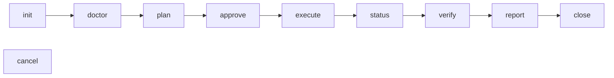

# Migmate

Finite, one-way movement or preservation of organizational content. The authoritative source is never modified, and every job leaves durable evidence of what was planned, processed, and verified.

Two job types:

- **File migration** — SharePoint document library to a Google Shared Drive folder, and Google Shared Drive folder to an existing SharePoint document library or folder.
- **Teams archive** — Microsoft Teams conversations to a local, offline HTML + JSONL package, optionally retained as conversation ZIPs in a Google Shared Drive folder.

`CONTEXT.md` is the glossary. It is the authority on what each term means; this README assumes it.

## Status

Pre-release. Releases are GitHub Releases cut from `v*` tags by `.github/workflows/release.yml`; nothing is published to npm, and merging to `main` does not release.

Two job types: file migration, and Teams archive with or without a Shared Drive destination. Archives support `retainedHistory`, `transcripts`, and `attachmentBytes`. File migrations approve mapping roots and options, execute rclone copy passes, and verify listings by path and size, including folders; content hashing is opt-in. Archives verify their local package and any uploaded copy. Blocking findings require acceptance before `close`. There is no per-route evidence gate ([ADR-0009](docs/adr/0009-per-job-verification-replaces-route-qualification.md)), so supported configurations run on all four platforms. Unsupported shapes refuse with `unsupported_route` (exit 4). Historical live observations and their limits are recorded in `docs/release-limits.md`; they do not prove the new rclone-executed file route.

## Requirements

- **Node 24.15.0 or later**, any later major included; the [installer](#install) supplies a private one when the host's is missing or older. The floor is not a taste preference: the durable store is `node:sqlite`, which is a release candidate rather than a stable API, and `24.15.0` is where it reached that tier — earlier 24.x carries a weaker one. An earlier runtime is refused as `usage` (exit 4 is for gates; this is exit 2) instead of reaching the store. `migmate --help` still answers anywhere, so an operator can read the requirement off the tool.
- **macOS 13.5+ or Linux**, on x64 or arm64. Any other platform is refused at install time by the `os` field, and `defaultHome` refuses it at runtime. Windows was removed deliberately — see `docs/adr/0002-drop-windows.md`.
- A desktop session only for `migmate web`, which opens a native WebView rather than serving a port.

`rclone` is vendored and checksum-pinned in the artifact. Do not install it separately.

Both version requirements live in `src/versions.ts`: an open Node floor, and an exact transfer binary pin whose narrowness that file explains and where widening it is decided. `package.json`'s `engines` mirrors the same Node floor for npm's benefit.

## Install

```sh
curl -fsSL https://github.com/devosurf/migmate-cli/releases/latest/download/install.sh | sh
```

The installer checks the platform, downloads the latest release (~117 MB, almost all of it the four vendored `rclone` builds) and verifies it against the release's `SHA256SUMS`, then writes a `migmate` launcher to `~/.local/bin`. It uses your `node` when it meets the release's Node floor and has npm beside it; otherwise it downloads a private Node from nodejs.org, checks it against nodejs.org's `SHASUMS256.txt`, and keeps it inside the install. It never edits shell startup files: when `~/.local/bin` is not on `PATH`, it prints the line to add.

Update with `migmate upgrade`, or run the same one-liner again. The previous version stays on disk until the next upgrade, so a job still running from it keeps its files.

The installer also installs Migmate's [agent skill](#driving-it-from-an-agent-or-ci) for the coding agents it finds: Claude Code, Codex, Gemini CLI, OpenCode, pi, omp, Cursor, GitHub Copilot CLI, Amp, Factory Droid and Goose, recognised by their config directory or binary. The first time, it lists them on the terminal (it reads the terminal, not the `curl` pipe); Enter accepts all of them, `none` or Ctrl-D declines. Without a terminal it takes every agent it found. It records the answer, and every upgrade refreshes the skill in the same places without asking again. One copy goes to `~/.agents/skills/migmate`, which most of these agents read. An agent with its own directory, such as Claude Code, gets a symlink to that copy, or a copy of its own when no agent reading the shared directory was chosen. A `migmate` skill the installer did not write is left alone. [docs/research/agent-skill-directories.md](docs/research/agent-skill-directories.md) records each agent's skill directory and its sources.

| Setting                               | Default                      | Effect                                                                                                                     |
| ------------------------------------- | ---------------------------- | -------------------------------------------------------------------------------------------------------------------------- |
| `--version X.Y.Z` / `MIGMATE_VERSION` | latest                       | Install or move to one release: `migmate upgrade --version X.Y.Z`                                                          |
| `--skills …` / `MIGMATE_SKILLS`       | recorded choice              | `ask`, `detected`, `none`, or agent ids such as `claude,codex`: `migmate upgrade --skills ask` changes the recorded choice |
| `MIGMATE_INSTALL_DIR`                 | `~/.local/share/migmate-cli` | Installed versions, any private Node, the `current` link and the recorded skill choice                                     |
| `MIGMATE_BIN_DIR`                     | `~/.local/bin`               | Where the `migmate` launcher goes                                                                                          |
| `MIGMATE_NODE`                        | `auto`                       | `system` insists on your Node; `bundled` always uses a private one                                                         |

Pass options through the pipe with `sh -s --`, for example `… | sh -s -- --version 0.1.0`. Uninstall with `migmate upgrade --skills none`, then `rm -rf ~/.local/share/migmate-cli ~/.local/bin/migmate`; job stores live elsewhere and are left alone.

### From source

```sh
git clone https://github.com/devosurf/migmate-cli.git
cd migmate-cli
npm ci
npm pack                                   # prepack builds and verifies the vendored binaries
npm install -g ./devosurf-migmate-*.tgz
migmate --help
```

`npm pack` produces a ~117 MB tarball that unpacks to ~348 MB; almost all of it is the four vendored `rclone` builds, which ship so that a transfer never depends on an unpinned binary.

To work in the repo without installing globally, `node dist/cli/main.js` after `npm run build` is equivalent to the `migmate` bin.

## Folder-local workspaces

A workspace is an ordinary project folder with a private `.migmate/` job store inside it.
Initialize that store and its first job once:

```sh
mkdir -p -m 700 "$HOME/Migrations/essense"
cd "$HOME/Migrations/essense"
migmate init --type file_migration --home .migmate --output json
```

Keep the returned job ID. Subsequent commands find the nearest `.migmate/` directory in
the current folder or its parents, including from subfolders and new terminal sessions:

```sh
migmate status --job "$ID" --output json
```

You still select a job with `--job`; a workspace can contain multiple file-migration
and Teams-archive jobs. The first job above is unconfigured: onboard its credentials
before `doctor` or `plan`, as described below.

Home selection is **`--home` → `MIGMATE_HOME` → nearest `.migmate/` → OS default**.
An explicit relative home is relative to the current working directory. If you previously
exported `MIGMATE_HOME`, unset it before relying on folder discovery. Outside a workspace,
existing global defaults are unchanged; no existing job data is moved and merely entering
a folder creates nothing.

A file or symlink named `.migmate`, or an error inspecting it, refuses rather than silently
using a parent workspace or the global store. Use `--home` to select a different store
explicitly; `--help` remains available.

The `.migmate/` directory holds durable plans, checkpoints, reports and archive content.
Keep it and customer inputs out of source control; this repository ignores `.migmate/`.
Credential files remain protected outside the repository and job directories.

## The lifecycle

Ten verbs on one rail, in this order:



`init` creates the job; `creds init` onboards an operator config onto it. `doctor` runs preflight — the checks only an administrator can satisfy, which refuse rather than retry. `plan` produces an immutable digest-bound proposal. `approve` binds an identity to that exact digest. `execute` does the work. `verify` compares the destination against the plan and raises findings; `accept` records an operator's acknowledgement of a finding as an exception, which never disappears from a report. `close` is terminal, and refuses while any blocking finding is unaccepted. With deferred member grants, confirming `close` also authorizes go-live.

With opt-in hash verification, a source that changed between copy and verify can raise three findings for one path: `source_size_inconsistent`, `size_mismatch`, and `content_mismatch`. `sourceSize` reports the size actually compared with `destinationSize`; when the listing contradicts served bytes, `listedSize` preserves the listing and the inconsistency finding also carries `servedSize`. The dependent size and content findings carry `cause: "source_size_inconsistent"` so they can be reviewed together. All three still block `close` until explicitly accepted; accepting the cause alone does not accept the other findings.

File-migration approval binds mapping roots, not individual files or unrelated destination contents. A missing root or changed root identity, drive, or folder type still refuses. Copies use rclone's path-based comparison: existing same-path content can be updated. **There is no file-level collision protection or compare-then-write guarantee.** Use dedicated destination roots and keep outside writers away during migration.

### Approve the map, verify by listing

Both existing file routes, SharePoint → Shared Drive and Shared Drive → SharePoint, use map-only planning:

- `plan` resolves each mapping's source and destination roots, drives to create, members and options. Approval binds that map, not a file list. Planning performs no per-file Graph inventory, file/deletion preview or inventory-freshness gate.
- rclone selects files by size and modification time and checks upload size.
- Default verification compares rclone listings by relative path and size, including folders and empty folders. It does not compare content bytes, and this disclosed limitation raises no degraded-content finding. Each verification covers whole mappings.
- Set `[options] verificationMode = "hash"` to opt into content verification. It downloads source bytes to compute the destination's hash type and compares with stored destination hashes, without a Graph inventory or destination download.
- On Shared Drive → SharePoint, size differences for PDF, Office and HTML files raise `destination_rewrote_file`; other size differences raise `size_mismatch`. On SharePoint → Shared Drive, served-size rewrites can still cause copy failures and `size_mismatch`.
- Final execution settles by comparing file and folder listings until nothing remains to copy or delete, within the configured catch-up bound.
- Mirror requires job-created-drive provenance and `deleteLimit`. File/folder listings of both sides immediately before every pass record deletion candidates as execute-phase `to_be_deleted` rows. The limit counts files, with folder removals recorded separately, and is enforced at execution rather than approval.

Version history, list-item fields, retention labels and permissions are not copied. The plan and report disclose these route-wide omissions once, not as per-file findings or accepted exceptions. OneNote notebooks copy as their section files, not as working Google notebooks. Mapping roots are the only scope selection.

Removed configuration fields (`proof`, mapping exclusions, `acceptedOmissions`, `oneNoteNotebooks`, `deltaVerification`, and `verificationMode = "size_only"`) refuse rather than acquiring new meanings. Old inventory-planned jobs refuse mutation; their historical status, evidence and reports remain readable. Historical CSV reports retain omissions accepted by the frozen plan's approval, including reports generated before verification; editing the current job config cannot change that decision. Start a new map-only job to continue migration under this behavior. Teams archive jobs are unchanged.

### Staged cutover: keep one job open

Prestage, approved deltas, and final cutover belong to **one open file-migration
job**. Decide mirror and its deletion limit before the initial manifest load;
closing is terminal, and a new job cannot inherit the closed job's mirror authority.
Configure staged intent before planning:

```toml
[options]
staged = true
consistencyIntervalMs = 30000
settleMaxPasses = 3
```

1. Load the manifest, run `plan`, review it and run interactive `approve --job "$ID"`, then `execute`
   and `verify`. Revisions are **prestage** until an execution completes, so
   replanning before then (unapproved, approved or interrupted) stays prestage;
   keep the job open.
2. As the source changes, repeat `plan` → review → `approve` → `execute` → `verify`
   in that same job. Ordinary revisions after a completed execution are
   **delta**. Review the mapping roots, options and any expanded authority.
   Mirror deletion candidates are listed and guarded at execution, not previewed
   for approval. Copy retains destination-only paths.
3. Arrange the source freeze with its accountable human, then make the final
   revision and hand the human interactive approval with a freeze attestation:

   ```sh
   migmate plan --job "$ID" --final --output json
   migmate approve --job "$ID" \
     --freeze-by "$FREEZE_OWNER" --freeze-at "2026-10-04T12:00:00Z" \
     --freeze-how "Source made read-only by the tenant administrator"
   migmate execute --job "$ID" --output json
   migmate verify --job "$ID" --output json
   migmate report --job "$ID" --output json
   ```

4. Review settling, full verification and any accepted exceptions before
   authorizing `close`. A staged job refuses `cutover_incomplete` unless its
   latest revision is final, settled and fully verified. A verified earlier
   revision cannot authorize closing a newer one.
   Approved staged intent belongs to the job's history: changing configuration
   or reloading a manifest cannot turn that job into an unstaged migration.

Final execution waits `consistencyIntervalMs` (default **30000**, a configurable
wait rather than a measured cloud-convergence guarantee), then compares source
and destination listings, including folders. It can make up to `settleMaxPasses`
additional catch-up passes (default **3**) within the approved mappings.
Confirmation that nothing remains to copy or delete is required before final
verification; exhaustion leaves cutover incomplete. Settling does not expand
deletion authority: the original authorization and cumulative limit remain in
force across final catch-up passes. Listing comparison establishes observed
quiescence, not a source snapshot or an administrator-enforced freeze.

Every verification covers whole mappings, including intermediate deltas.
Listing verification is the default; opt-in hash verification changes the
content check, not the scope.

The web **plan** stage offers **Make final cutover plan**; final approval asks
who froze the source, when (a timestamp with timezone), and how. This durable
attestation is a human assertion, **not an automatic tenant lock**. Observed
quiet and verification do not by themselves prove exact cutover parity.
Omissions, retained destination-only content and accepted exceptions continue to
qualify the report even with a freeze.

### Observed uploads in one engine home

`status.uploadActivity` shows **job-content uploads observed in this engine home**,
by the provider-observed, approved acting Google account. All jobs using the same
home (`MIGMATE_HOME`, or the home selected above) share its private `uploads.sqlite`
ledger. Account emails are trimmed and case-normalized; changing credential files
does not reset an account total. Unknown identities remain separate job/attempt
evidence. Teams Google destinations bind their observed account too.
File accounting follows the destination adapter's policy: Google Shared Drive
destinations contribute; SharePoint destinations do not. The retired `route`
option is not an accounting switch.

The trailing window is `(asOf - 24 hours, asOf]`, independent of midnight. It
includes SharePoint-to-Google copy counters and acknowledged Teams cold-storage
content chunks, even from failed or interrupted attempts. Recovered archive
objects add no upload bytes. It excludes downloads, reverse-route uploads,
local-only archives/packaging, verification, metadata/HTTP overhead and preflight
test uploads. **Other engine homes, other hosts and non-Migmate uploads are
unobserved; there is no cross-home or cross-host coordination.**

Read each account's `gaps`, `coverageStart` and `complete` alongside its partial
`observedBytesInWindow`. New/older uninstrumented history, unknown identities,
crashes, missing final counters, counter decreases and sampling gaps keep
`estimatedRemainingBytes` unavailable (`null`). File samples normally arrive
about every ten seconds; archive samples follow bounded acknowledged chunks.
Intervals longer than 30 seconds disclose uncertain timing rather than pretending
all accumulated bytes were uploaded at the end. Counter-reset uncertainty extends
through the affected attempt's termination. Clock rollback behind durable ledger
timestamps excludes future bytes and withholds an allowance estimate until the
clock catches up. A stop acknowledgment alone does not establish a final counter:
interruption and consumer-exit cleanup reconcile available worker stats, but
unconfirmed termination remains an open gap until writer recovery proves the
worker ended. Expiry alone does not repair an unresolved attempt.

Only complete local coverage produces `max(0, 750,000,000,000 - observedBytes)`.
**750 GB is decimal; this is an estimate, not Google's remaining quota, a safe
upload budget, reservation or reset clock.** Retry accounting and excluded
activity can make it overstate or understate actual allowance. Plans retain a
dated snapshot; later status reads do not change approval. Planned upload bytes
remain unavailable: no planning scan or predicted-size warning is added, and
Migmate cannot assess whether a plan fits the allowance. Non-upload routes are
not applicable.

Measurements are retained for 48 hours with writer-side pruning; compact attempt
checkpoints survive for the ledger's lifetime. Status does not repair or prune the
ledger. Keep it with the engine home; deleting it loses observation history, not
Google's quota usage. Accounting failures are surfaced instead of an empty total.
If execute cannot verify the approved acting Google account, it refuses
`preflight_failed` with safe provider evidence; an observed identity change still
requires a new plan. Cancellation remains cancellation, not an identity mismatch.
The estimate never gates execution or changes concurrency. Provider-observed
quota stops and manual `execute` resume remain unchanged, with no automatic wait
or guaranteed reset time.

### Acting Google account

File jobs optionally enable domain-wide delegation with top-level job TOML settings
(before any table header):

```toml
impersonate = true
subject = "files@example.com"
```

With impersonation omitted or `false`, the service account acts as itself; the plan
and report name its email address observed in preflight.
For delegation, a Workspace administrator authorizes the service account's **numeric
client id** (from its JSON key, not its email) with only
`https://www.googleapis.com/auth/drive`. Choose an ordinary **non-admin subject**
and give that account access to each destination. Migmate cannot check admin status
without Admin SDK scopes and never requests them; checking it is the operator's responsibility.
Delegation is a domain-wide key, not access limited to the named subject.

Preflight proves Google issues a subject token and `about.user.emailAddress` equals
the configured subject; failures name the delegation fix. Migmate requests only the
Drive scope and injects `impersonate` into each mapping's rclone connection string.
Keep `impersonate` out of the operator's rclone config: its strict allowlist refuses it.
The rclone remotes name no root either: `drive_id` (SharePoint), `team_drive` and
`root_folder_id` are optional, because every pass overrides them with the approved
mapping's roots. Leave them out, particularly when a manifest creates the destination
drive; a value that is set must still be a stable ID.
Plan and report show the acting account. The closing report leaves deleting the
service-account key and deleting the delegation entry as open operator tasks;
Migmate does not perform those administrative deletions. A manifest that creates
Shared Drives also requires `about.canCreateDrives = true` in preflight.

### File provider selection

Set both providers at the top level of the operator TOML, before any table header:

```toml
sourceProvider = "sharepoint"
destinationProvider = "google_shared_drive"
```

For the reverse direction, use `sourceProvider = "google_shared_drive"` and
`destinationProvider = "sharepoint"`. These are the only supported file-provider
pairs; Dropbox, same-provider copies and every other pair refuse `unsupported_route`.
An empty config defaults to the forward pair; saved file configs name both providers.
New file configs containing `route` refuse `configuration_invalid`: replace that
field with `sourceProvider` and `destinationProvider` as shown above, rather than
renaming its old value. Historical persisted `job.toml` route values are decoded
without rewriting them; historical status and reports remain readable. Their recorded
close authorizations and go-live acknowledgments retain the frozen plan's original
digest encoding. Equivalent provider-pair spelling preserves those bindings; changing
the current authority-bearing settings does not.
Teams archives retain `route = "teams_global_archive"`.

### Mapping manifests

Load a batch with `migmate manifest load --job "$ID" --file mappings.json --output json`.
Configure the job's credential references first (`init --config job.toml` or
`creds init --job "$ID" --config job.toml`). The config may omit `[[mappings]]`;
credential onboarding and `doctor` work before the manifest exists. Load resolves
source paths and both trees' ancestry through the providers. Until mappings are
loaded, `plan` refuses `configuration_invalid` (exit 2), with `detail.field: "mappings"`
and guidance to run `manifest load`. JSON is authoritative:

```json
{
  "version": 1,
  "mappings": [
    {
      "id": "finance",
      "source": {
        "type": "sharepoint",
        "driveId": "sharepoint-library-id",
        "folderPath": "Reports/2026"
      },
      "destination": {
        "type": "google_shared_drive",
        "driveId": "shared-drive-id",
        "folderId": "existing-folder-id"
      }
    }
  ]
}
```

`folderPath` is a literal, unescaped path relative to the SharePoint drive root;
`""` selects the whole library. Use `/` between segments, without leading/trailing
slashes, empty segments, `.` or `..`. IDs are stable provider IDs, not URLs or the
alias `root`; mapping IDs must be unique. Both roots must be ordinary folders.
Mappings overlap if their source roots in the same drive are equal or one is an
ancestor of the other, **or** their destination roots in the same Shared Drive are
equal or nested. Sibling trees are allowed; mapping roots alone define scope.

For a new Shared Drive, replace `destination` with
`{ "type": "google_shared_drive", "create": "Finance" }` and optionally add
`members` beside `source` and `destination`:

```json
{
  "members": [
    { "email": "finance@example.com", "type": "group", "role": "fileOrganizer" },
    { "email": "reviewer@example.com", "type": "user", "role": "reader" }
  ]
}
```

The drive root becomes the destination folder. Existing destinations and drives
to create may coexist in one manifest. Members apply only to drives the job
creates; types are `user` or `group`. Shared roles are `reader`, `writer`, and
`manager`; Google maps `manager` to `organizer` and leaves `reader`/`writer` unchanged.
Google-native `organizer`, `fileOrganizer`, and `commenter` are also valid.
SharePoint maps shared roles to `read`, `write`, and `owner`, respectively, but
SharePoint container creation and membership are not shipped: reverse jobs require
existing destinations and cannot declare members. `anyone` and `domain` refuse at
load, naming the row and `members.N.type`. Emails are case-insensitive and duplicates refuse.

**Member grant timing.**

File jobs bind `[options] memberGrants` into the approved plan. Unstaged jobs
default to `"before_copy"` (unchanged); staged jobs default to
`"after_verification"`. Either default can be explicitly overridden:

```toml
[options]
staged = true
memberGrants = "after_verification" # or "before_copy"
```

Plan and report disclose the effective mode beside Mirror and Copy concurrency.
With `before_copy`, execute creates drives and grants manifest members before
copying. With `after_verification`, execute creates drives and copies without
granting manifest members; `status.memberGrants` stays empty through execution.
A verified prestage or intermediate delta does not grant access.

Verify, review the pre-close report, and explicitly accept any blocking findings
before the human runs `migmate close --job "$ID"` or confirms close in the web view.
The confirmation captures the exact reviewed evidence and an editable, unverified
declared identity. For staged jobs, the latest revision must also be final,
settled and fully verified. Deferred close renders and publishes the readiness
report before recording authorization, fencing or granting access. A readiness
failure therefore grants nothing. It checks every affected destination against
the current verification baseline **before any new fence or grant**. Failed or
unavailable pre-grant proof refuses the entire batch without new fences or grants;
repair and reverification remain possible under the ordinary approval rules.
After all destinations pass, close fences the whole batch before the first grant
request, grants approved members, checks explicit membership, and writes
timestamped evidence and the final report before closing. The moved content check
is not repeated after new grants.

If close fails or is interrupted after authorization, unchanged durable authority
permits `close` to resume without repeating the initial go-live challenge.
`status.closeAuthorization.evidenceDigest` must match `status.closeReview.evidenceDigest`,
with `closeReview.authorized = true`; conversation memory is not recovery authority.
Recovery preserves passed checks and explicitly acknowledged failed or unavailable
checks, resuming only unfinished grants, checks and reporting. **Some access may
already exist after a failed close.** Retry unresolved checks with `close`, or review
`status.goLiveReview` and hand the human `migmate acknowledge --job "$ID"` or the
acknowledgment form in the web close view. In the terminal, select the displayed
failure numbers (mapping IDs may contain commas or surrounding spaces); the web view
uses checkboxes. Supply one non-empty rationale and confirm with the existing
unverified declared identity.
The decision is bound to the displayed evidence and authority; stale submissions
refuse. Initial go-live authorization never acknowledges later failures.

Eligible post-grant failures are `drive_membership_mismatch` (missing/extra members
or changed roles), `go_live_check_unavailable` (still unverified), and recorded
`destination_drift` in already-live jobs (original baseline retained). Acknowledgment
records the specific risk, not a passed check or proof that drift is legitimate.
It cannot waive pre-grant proof, accept other/future failures, abandon incomplete
grants, repair permissions or close the job. An already-live drive without passed
pre-grant proof whose membership check failed never observed its content: after
that membership difference is acknowledged, `close` still checks the destination
against the original verification baseline and records `goLive.destinationCheck`;
a failed or unavailable result needs its own acknowledgment. Observe
`status.goLiveAcknowledgments`, then separately retry `close`.

Once fenced, copy/mirror and `cancel` refuse `go_live_started` (exit 4). The final
report remains mandatory. Checks record observations at their original timestamps,
not a guarantee against later changes. Destination proof compares file paths,
sizes, stored hashes and IDs plus folder paths with verification; it is not another
content download or a destination lock. Membership proof covers explicit drive
members, not inherited permissions or effective group membership.

After deferred go-live starts, `status.incompleteClose` survives reopening and
explicitly reports `accessMayExist`, the permanent transfer fence, `checksPassed`,
`checksSettled` (passed or exactly acknowledged), and whether reporting is `unfinished`
or `complete`. A `verified` state with this disclosure is **not a completed close**.
Pre-grant evidence is in `status.createdDrives[].preGrantCheck`; grants and post-grant
checks remain in `status.memberGrants` and `status.createdDrives[].goLive` (`check`,
plus `destinationCheck` for separately finished already-live content proof).
Acknowledgment records retain selected evidence, rationale, identity, mode and time.
Closure relying on an acknowledgment returns and records `completed_with_accepted_exceptions`
in `status.closureOutcome` and the final report's `job.closureOutcome`, even without
verification exceptions. Failed checks remain failed; unavailable checks remain
unverified. Report failure leaves the job incomplete; fix reporting and retry
`close` without rechecking settled evidence or repeating acknowledgment.

Reports stream complete rows, findings, accepted exceptions and driver evidence,
including settled inventories, into JSON, JSONL and HTML while hashing the bytes.
The whole artifact set is published only after every artifact finishes; a failed
attempt leaves earlier immutable reports intact. Large reports still need disk
space for the complete set and its temporary staging copy. JSONL keeps its
existing header shape: that first record can itself exceed a runtime's string
limit, so large-report consumers must parse it incrementally rather than load a
whole line or file.

File-migration reports also publish two incremental, digest-bound handover files.
`report --output json` and the reader's artifact list include both alongside
`report.json`, `report.jsonl` and `report.html`; unchanged evidence produces the
same artifact set and digests. Teams archive reports and packages are unchanged.

- **`mappings.csv`** has one row per mapping in the current revision. Columns:
  `mapping_id`, `source_type`, `source_drive_id`, `source_folder_path`,
  `source_site_name`, `source_library_name`, `destination_type`,
  `destination_drive_id`, `destination_name`, `destination_web_link`,
  `created_by_job`, `files`, `bytes`, `verification_outcome`,
  `outstanding_exceptions`, `accepted_exceptions`, `go_live_member_grants`,
  `freeze_by`, `freeze_at`, `freeze_how`, `go_live_pre_grant_check`, `go_live_check`,
  `go_live_destination_check`, `go_live_acknowledgments`. Files and bytes are the latest completed
  pass's recorded totals, not an inventory or a sum of attempts. Verification is
  `clean` or `findings` (acceptance does not turn findings into proof), or empty
  before verification. Exception counts cover verification findings, not go-live
  checks. Go-live grants are a JSON array of the recorded mapping/drive/member/timestamp
  objects; before-copy grants are not
  presented as go-live. Freeze cells contain the current final approval's human
  attestation, not an assertion that Migmate locked the source.
  A destination's planned creation name is available before execute, but
  `created_by_job` becomes `true` only once a created drive ID is recorded.
- **`exceptions.csv`** has one row per verification finding, plus current
  failed/unavailable go-live checks. Accepted exceptions are not duplicated.
  Columns: `mapping_id`, `path`, `code`, `status`, `approver`, `note`, `reason`.
  Status is `outstanding` or `accepted`; approver and note come from recorded
  acceptance, and reason is the finding's recorded reason text.
  Route-wide omissions are disclosed separately, not counted as exceptions.
  Go-live rows retain the failed check code and recorded evidence in `reason`;
  their status is `outstanding (failed)`, `outstanding (unverified)`,
  `acknowledged (failed)` or `acknowledged (unverified)`. Acknowledged rows carry
  the declared approver and shared rationale in `note`. Full check/decision records
  are also retained in the mapping CSV and JSON/JSONL/HTML report.
  File reports disclose route-wide omissions and verification scope rather than
  generating per-file omission rows.

These are views of existing report evidence, not additional provider observations.
Unknown values are empty cells: in particular, existing destination names, source
site/library names and destination web links are not synthesized from IDs or URLs.
Every field is double-quoted, internal quotes are doubled, and commas, newlines
and leading `=`, `+`, `-` or `@` remain verbatim, matching the archive CSV convention.
Import cells as **text** in spreadsheet software rather than allowing formula
interpretation; CSV quoting preserves data but is not a spreadsheet execution policy.

In either mode, plan/report warn that mirror can overwrite or delete existing
writers' files. Deferring manifest grants does not revoke or exclude external
access, administrators, existing drive members or members of pre-populated groups.
The acting account needs organizer access; restricting other access is an operator
precondition, not a Migmate isolation guarantee.

For existing destinations, CSV accepts this exact seven-column header:

```csv
id,source.type,source.driveId,source.folderPath,destination.type,destination.driveId,destination.folderId
finance,sharepoint,sharepoint-library-id,Reports/2026,google_shared_drive,shared-drive-id,existing-folder-id
```

For provisioning, use the exact nine-column layout below. Leave existing
destination IDs empty when `destination.create` is set; the `members` cell is
a JSON array encoded as a CSV string. Leave the two added cells empty for existing
destinations in a mixed manifest.

```csv
id,source.type,source.driveId,source.folderPath,destination.type,destination.driveId,destination.folderId,destination.create,members
finance,sharepoint,sharepoint-library-id,Reports/2026,google_shared_drive,,,Finance,"[{""email"":""finance@example.com"",""type"":""group"",""role"":""writer""}]"
```

Use UTF-8 and standard double-quoted CSV cells (double a quote inside a quoted cell);
LF and CRLF are accepted. An empty source path is an empty cell. Validation refuses
with `configuration_invalid` (exit 2), `refusal.detail.row` (one-based mapping/data
record; 0 means document/header), and `refusal.detail.field`. JSON fields and CSV
columns are strict: every unknown field refuses rather than being ignored.

A successful load replaces the entire mapping set in SQLite, not the credential
settings. Mappings live in SQLite rather than `job.toml`. The plan freezes
the resolved mappings and `manifestDigest` (SHA-256 of canonical versioned JSON,
ordered by mapping ID). Editing the input file has no effect until another load.
Loading after planning/approval collects a new revision requiring approval again.
If recollection fails, the loaded set remains but the prior approval cannot run:
correct the reported prerequisite and run `plan`, then approve its digest.
An approval written before manifest support keeps its original frozen input identity
when its config mappings migrate, so unchanged approved or interrupted jobs can resume.
The manifest digest is bound when a new plan is collected, not retroactively added to
the old approval.

For large jobs use `plan --review --view mappings --limit 50` or
`status --view mappings --limit 50`, both with `--job "$ID" --output json`.
Continue with `review.nextCursor` via `--cursor`; use `--search TEXT` for a substring
filter, `--mapping ID` for an exact mapping, or `--code CODE`. Counts/facets cover
the entire filtered set. Mapping rows are ordered by ID, include the frozen definition
and latest `mappingPass` when planned, and are available before planning as loaded
definitions. `--revision N` reviews earlier plans. Mapping view omits the unpaged
top-level `mappingPasses`; default item view retains it. `--mapping` also filters
item rows.

### Google Shared Drives to SharePoint

A job whose top-level TOML sets `sourceProvider = "google_shared_drive"` and
`destinationProvider = "sharepoint"` copies Google Shared Drive folders into existing
SharePoint document libraries or folders. The provider pair fixes one direction for the
whole job and is frozen into the plan and report: `manifest load` refuses any row in the
other direction, including every row of a mixed manifest, with its row and `source.type`.
Each reverse mapping looks like:

```json
{
  "id": "archive",
  "source": {
    "type": "google_shared_drive",
    "driveId": "shared-drive-id",
    "folderId": "folder-id"
  },
  "destination": {
    "type": "sharepoint",
    "driveId": "sharepoint-library-id",
    "folderPath": "Imported/2026"
  }
}
```

`source.folderId` is the source folder's stable Drive ID. `destination.folderPath`
follows the source `folderPath` rules above; `""` selects the library root. The
library and folder must already exist: Migmate creates no SharePoint sites,
libraries or folders, so `create`, `members` and `mirror` refuse for these mappings.
CSV uses the exact eleven-column layout, which appends `source.folderId` and
`destination.folderPath`; leave `source.folderPath`, `destination.folderId`,
`destination.create` and `members` empty on reverse rows:

```csv
id,source.type,source.driveId,source.folderPath,destination.type,destination.driveId,destination.folderId,destination.create,members,source.folderId,destination.folderPath
archive,google_shared_drive,shared-drive-id,,sharepoint,sharepoint-library-id,,,,folder-id,Imported/2026
```

Sources are read as the [acting Google account](#acting-google-account), which must
already be a member of every source Shared Drive; Migmate never adds it. `manifest load`
and preflight check each source drive and refuse `preflight_failed`, naming every drive
it cannot read in `unreadableSourceDrives`.

SharePoint is written only by a separate destination app. Name its rclone remote as
`sharepointDestinationRemote` in the job's `[rclone]` table, beside the Google
`destinationRemote`; `sourceRemote` is needed only for SharePoint-source mappings.
The rclone config file holds exactly the named remotes. The remote is an `onedrive`
document-library remote with client credentials and the same strict key allowlist
as the source remote, minus `root_folder_id`. Its app's token must carry exactly
`Sites.ReadWrite.All`; any other role set, or the source app's client ID, refuses
`credential_permissions_invalid`. The SharePoint source app keeps its own read-only
allowlist. Before mappings exist, the configured route determines the remotes:
the default SharePoint-source route requires `sourceRemote` and refuses
`sharepointDestinationRemote`; the explicit reverse route requires
`sharepointDestinationRemote` and needs no `sourceRemote`. Once loaded, each mapping
must have the credentials its direction needs. A job that only reads SharePoint
never holds its write credential; an unnecessary destination remote refuses
`credential_config_invalid`. `scripts/stage1-prereqs.sh` can write a separate reverse job config.

Each pass addresses the destination as a path under the library pinned by
`drive_id`, never `root_folder_id`, and runs with `--ignore-size --ignore-checksum`,
because SharePoint may rewrite PDF, Office and HTML files on upload. Verification
downloads each source file to compute its quickXorHash and compares it with the hash
SharePoint stores. A differing PDF, Office or HTML file raises
`destination_rewrote_file`; any other differing file raises `content_mismatch` (and
`size_mismatch` when lengths differ). Both carry `sourceHash`, `destinationHash`,
`sourceSize` and `destinationSize`, and block `close` until accepted by code, so
rewritten documents can be accepted as a group without accepting corruption.

### Shared Drive provisioning and recovery

The plan lists each drive to create and its members and roles. Before any copy,
`execute` creates drives as the acting account, using a request ID derived from
the job ID and mapping ID. Creation intent and returned drive ID are checkpointed;
the ID is durable **before** any member is added. Member grants use
`supportsAllDrives=true` and `sendNotificationEmail=false`, and are checkpointed too.

A lost creation response, including a replay returning HTTP 409, is recovered by
listing drives visible to the acting account with exactly the planned name.
One match is adopted only if its Google `createdTime` is at or after the job's
durably recorded creation intent. An older match, missing timestamp or legacy
intent without a timestamp refuses with `drive_creation_ambiguous` (exit 4),
including candidate evidence. None retries the same creation request; several
matches also refuse. Never guess a match.
After a crash, rerun `execute`: a stored drive ID is reused without name lookup,
and an already-present matching member grant is recorded without submitting it again.
Once creation has been submitted, its mapping ID cannot be reused with a different
creation name. Use the existing destination ID rather than changing that intent.

Google automatically grants the creator `organizer`. Verification compares the
manifest members plus that implicit creator (unless explicitly listed) against
the drive's complete membership. Missing, extra, or changed grants raise
`drive_membership_mismatch`, with expected and actual memberships in the report;
the finding blocks `close` until accepted. Verification and execute replay do not
repair already-checkpointed grants. Members removed from a later manifest are
not revoked automatically; they appear as drift.

`status.createdDrives` exposes mapping, request ID, nullable drive ID, planned name,
creator email, intent timestamp and creation provenance (own create response or
timestamp-checked name recovery); a null drive ID is an unresolved creation intent.
`status.memberGrants` and the report retain completed grants. Existing destination
memberships are neither managed nor verified. Provisioning is covered by fake
provider and HTTP-transport contracts; this does not claim a live tenant run.

### OneNote notebooks

Notebooks copy as folders of section files, including `.one` files and
`Open Notebook.onetoc2`, through ordinary copy, delta, mirror and verification.
There is no notebook policy option or per-notebook omission finding.

This is a **read-only reference copy**, not a working notebook in Google.
Download the whole folder and open `Open Notebook.onetoc2` in OneNote for Windows.
It does not open on Mac or in Drive. Editing through Drive for desktop is unsafe:
notebooks must sync through OneNote itself, not a file-sync client. “Read-only”
describes intended use, not a Drive permission enforced by Migmate.

### File mapping copies and recovery

Copy passes run concurrently inside the run's single managed rclone worker; one lifecycle writer still records their checkpoints serially. Shared Drive provisioning completes before copying.

The managed worker enables rclone's `--fast-list` for copy/mirror passes, folder listings, and hash listings. Backends such as Google Drive can use recursive ListR traversal to reduce listing API requests; backends without ListR retain ordinary traversal. This trades additional memory for fewer listing requests, not a measured tenant throughput guarantee. Mapping roots, empty-folder coverage and mirror deletion caps are unchanged. Verification makes independent observations rather than reusing copy listings. Failed mappings still retry their whole scope; this is not per-file retry or adaptive throttling.

The job's `[options]` controls both limits, shown in the immutable plan's **Copy concurrency** section and the report:

```toml
[options]
mappingsInFlight = 2
transfersPerMapping = 4
```

These are conservative defaults: two active mappings, each with up to four file transfers (eight in total). Both settings accept positive safe integers; set `mappingsInFlight = 1` for serial mapping copies. Raising them increases simultaneous provider work and may increase throttling; they are not tenant-throughput guarantees. The next queued mapping starts as a slot frees, rather than waiting for a whole batch.

`status` exposes durable `mappingPasses`: mapping and pass number, mode, rclone handle, state, timestamps, last stats and error. rclone's backend pacer handles throttling within each pass. An ordinary failed pass retains rclone's error and counts against the run's retry budget without stopping other active or queued mappings; the run remains blocked if any pass fails. Run `execute` again to retry failed or interrupted mappings; completed mappings in the approved revision are skipped. On writer-open recovery, every unfinished pass whose worker is gone becomes interrupted, including all passes active at a crash. A retried copy lets rclone skip identical files instead of recovering per-file uploads.

**Google upload quota is different.** Google documents [750 GB per user per day](https://developers.google.com/workspace/drive/api/guides/limits#additional_constraints) across My Drive and Shared Drives. For file uploads into Drive, the worker uses `--drive-stop-on-upload-limit`. On the first detected upload-quota failure, Migmate cooperatively stops the other active passes, starts no queued mapping, and returns `blocked` (exit **5**). All mappings share the job's acting Google account. The execute result and terminal event carry `uploadQuota`; the failed pass retains it in `status.mappingPasses[].uploadQuota`, alongside the original error:

```json
{
  "code": "upload_quota_exceeded",
  "hitAt": "2026-10-08T12:00:00.000Z",
  "actingGoogleAccount": "files@example.com",
  "earliestResumeAt": "2026-10-09T12:00:00.000Z",
  "resumeTimeIsEstimate": true
}
```

`hitAt` is when Migmate observed the failure. The account comes from plan evidence, falling back to the impersonation subject (or `null` for an older non-impersonated plan without that evidence). `earliestResumeAt` is hit time plus 24 hours, an **estimate**, not Google's reset clock or a guaranteed allowance. Wait until that estimate before retrying `execute` on the same job; an earlier manual retry is allowed. There is no automatic quota resume or allowance warning. The engine-home ledger separately reports trailing-24-hour observed bytes with gaps; it does not gate resumption. Quota stops do not count against the ordinary failure budget. Because rclone's aggregate cannot separate quota errors from file failures, the quota pass's final `lastStats.errors` and progress `errors` are `null` (unknown), with the raw aggregate preserved as `rcloneErrors`, not an ordinary per-file failure count. Other Drive limits (storage, Shared Drive file count, downloads, ordinary API throttling) do not receive this daily-upload classification.

Ctrl-C (SIGINT, exit **130**), SIGTERM (exit **143**) and terminal hangup (SIGHUP, exit **129**) stop foreground work cooperatively. Active passes are checkpointed and stopped; after successful worker cleanup and lease release the job remains resumable, not cancelled. Read `status`, then repeat `execute` without `reclaim`: interrupted/failed passes resume and completed passes are skipped. `execute --output jsonl` emits `mapping_progress` events with `mappingId`, `passNumber`, `bytes`, `files`, `speed`, and `errors`. These statistics describe copying; `verify` supplies the content proof.

Routine mapping statistics are durably sampled at most once per **10 seconds per revision, mapping and pass**. The first available snapshot, status/error changes and final statistics are captured immediately, even for a short or interrupted pass. Polling for completion and cancellation continues independently of sampling; suppressed observations create no commits or events. Status, the web view and reports show the latest durable sample.

New snapshots and `mapping_progress` events include at most **five** `transferring` entries. `transferringTotal` gives the complete in-flight count and `transferringTruncated` indicates omitted detail; byte, file and error totals are not truncated. Events also retain the pass's `error` message (or `null`). Older stored evidence remains readable and is not compacted. Live JSONL and cursor replay still read the same durable log and return identical event envelopes.

`plan` also stops cooperatively on those signals, including full file inventories and Teams archive collection. In-flight provider reads are aborted and the writer lease is released; an incomplete collection does not become an approvable plan. Run plain `plan --job ID` again, not `reclaim` or `execute`, to collect a complete revision. An earlier completed plan is retained until a new one completes. An interrupted `verify` publishes no successful verification; read `status` and repeat `verify`.

A full or disconnected output pipe does not prevent cooperative cleanup; SIGHUP still exits **129** when its output cannot flush. SIGKILL, machine loss and failed worker cleanup cannot guarantee lease release or recovery without `reclaim`; inspect durable `status` and worker ownership before recovery.

For execution independent of a terminal, use `migmate execute --job ID --detach`. The launcher exits successfully only after the background coordinator acquires its own writer lease and passes execute admission. Refusals (including an unapproved plan or another owner) exit nonzero without a false “started” acknowledgement. Duplicate foreground or detached launches refuse `lease_held` (exit **3**). Only `execute` supports `--detach`; combine it with text or JSON output, not JSONL.

Generated status, stop, cancel and resume commands retain the resolved `--home`, shell-quoted so they address the same job from another directory or terminal. Stop/cancel also reach an idle or actively executing web-owned job; the window releases its writer and becomes read-only after the admitted request settles.

The acknowledgement names the coordinator PID and private attempt log. `status.ownership` records `detached` and the job-folder-relative `logPath`; it is recorded ownership, not a liveness probe. Tail `<job>/logs/execute-<UTC start>-<commandId>.jsonl` for redacted JSONL events and the final result envelope. The directory is mode 0700 and each exclusive file 0600. Refused launches retain their logs too; logs are never overwritten or automatically pruned. The durable event log remains the authoritative record. A failed log write interrupts execution resumably.

Use `migmate stop --job ID` for a resumable stop or `migmate cancel --job ID --reason TEXT` for terminal cancellation, including while a foreground or detached command owns the job. Requests bind to the lease owner's UUID, never its PID. The requester waits for acknowledgement, worker cleanup and lease release; successful stop or cancel exits **0**. A foreground owner exits **130** for stop or **7** for cancellation. Read `status` and repeat the indicated command after stop; `execute` resumes without `reclaim`. Stop with no owner succeeds with `stopped: false`. Repeated stop requests join; cancel upgrades a pending stop. Ctrl-C ends the requester, not the delivered request. Closed/cancelled jobs refuse with **6**/**7**; foreign or stale ownership refuses with **3** and requires the existing recovery guidance.

A detached coordinator survives terminal closure and SSH disconnect, not reboot or shutdown. Linux logout with systemd `KillUserProcesses=yes` also stops it; use `loginctl enable-linger` where appropriate. After host loss, inspect `status`, resume with `execute`, or use `reclaim` when ownership evidence requires it. macOS sleep pauses progress; `caffeinate -i -w <PID>` keeps the machine awake for that coordinator. Migmate makes no power assertion and never automatically restarts.

The web view's **execute** and **status** stages show each mapping's pass number, state, bytes, files, speed, error count, and failure message. Pending passes show unknown statistics until rclone reports them; earlier attempts remain visible alongside resumed passes.

rclone copies empty folders and preserves supported created/modified times and Google Drive content type through metadata; created time on Drive applies to fresh uploads. Folders receive modification times only: rclone v1.75.0's Drive backend applies a folder's source content type (SharePoint reports `inode/directory`) to the folder it creates, which makes a 0-byte file instead of a folder, so the worker never writes folder metadata. Owner, permission and label metadata are off. SharePoint roots are paths inside a drive pinned by id, never SharePoint `root_folder_id`; per-mapping connection overrides reuse the operator's two remotes. Copy never deletes: renamed or removed source files can leave destination-only files, reported nonblockingly by verification.

On both file routes, verification checks that every expected folder exists at the destination, including empty folders, in both hash and size-only modes. A missing folder raises blocking `destination_missing`; a file at its path raises blocking `destination_type_conflict`, rather than the nonblocking `destination_only_retained`. Excluded and omitted folders and their descendants are outside this check. File and folder metadata are not verified.

#### Mirror for job-created drives

Copy is the default, including repeat passes. To remove destination-only files,
set both settings in the job TOML before loading a manifest:

```toml
[options]
mirror = true
deleteLimit = 100
```

`deleteLimit` is a required nonnegative safe integer: the maximum file deletions
**per mapping pass**, not a pooled job allowance; `0` prohibits file deletion.
Every mapping must use `destination.create`. An existing destination ID refuses
with `configuration_invalid`, the mapping row and `field: "destination"`, even if
that ID names a drive created earlier. Keep the same mapping ID and `create` intent
on later manifest loads so the job reuses its durable created-drive ID.
The plan and report's **Mirror** section state whether mirror is on and its limit.
Before submitting a mirror pass, Migmate also checks the created drive's durable
provenance. Legacy records without this proof fail that mapping with a provenance
error rather than deleting; other mappings continue. Copy mode remains available.

Mirror runs rclone `sync/sync`; exceeding the limit fails that mapping with
rclone's error without deleting beyond the cap, while other mappings continue.
Deletions already within the cap are not rolled back; ordinary retries have a fresh
per-pass cap, while final settle catch-up passes share the original cumulative
deletion authorization. For a repeat pass after source changes, run `plan`, approve
its new digest, then `execute` and `verify`; replaying a completed revision skips its passes.
A successful mirror removes leftovers, so verification reports no
`destination_only_retained` for an unchanged source/destination after the pass.
Verification still reports any leftovers it actually observes (for example,
outside writes after the pass); mirror never suppresses that evidence.

File migration no longer stages file bytes locally or uses reserved destination IDs, private provenance markers, or move-by-id. Teams archive uploads retain their separate create-only protections.

A minimal file-migration job, with human decisions in their terminal:

```sh
migmate init --type file_migration --config job.toml --output json  # -> job id
migmate manifest load --job "$ID" --file mappings.json --output json
migmate doctor --job "$ID" --output json
migmate plan   --job "$ID" --output json                  # -> planDigest
migmate approve --job "$ID"                               # human review and confirmation
migmate execute --job "$ID" --output json
migmate verify  --job "$ID" --output json
# If findings need acceptance: human runs migmate accept --job "$ID"
migmate report  --job "$ID" --output json
migmate close   --job "$ID"                               # human go-live confirmation
```

Read `plan` and `verify` evidence without taking a writer lease by adding `--review`. Only one writer holds a job at a time. The next writer automatically takes over a crashed writer's same-host lease once its heartbeat is 30 seconds stale and its process and worker are gone, recording recovery in the job's events. Use `reclaim --job ID --confirm --stop-worker` to stop a recorded orphan worker; explicit `reclaim --confirm` remains available for recovery without opening a writer. Never delete lease files by hand.

In `migmate web`, tick the confirmation checkbox beside **Quit process safely**, then click the button to interrupt at a safe checkpoint and release the writer lease. This confirmation stays inside the page; it does not depend on a native JavaScript dialog. Closing only the window does not interrupt an active run.

## Credentials

Operator config carries **credential references** — typed pointers to operator-owned files — never secret values. Migmate resolves a reference just in time and never copies the bytes into durable state. Reference files must be regular files owned by the invoking user carrying no group or other permission bits — `0600`, or stricter — and live outside the repository; the engine and the live test runner both refuse anything looser.

`scripts/stage1-prereqs.sh` (file route) and `scripts/archive-prereqs.sh` (archive route) are interactive wizards that walk the tenant setup a human has to do, and write those files. Both take `--resume <env-file>` to re-emit config without walking the tenant again.

### SharePoint source grants and discovery

Choose exactly one Microsoft Graph **application** permission on the source app:

- `Sites.Selected`: least privilege for a few sites, with an explicit **read** grant
  on every source site. A leaked key reaches only those granted sites. It cannot
  enumerate the tenant for discovery.
- `Sites.Read.All`: one admin consent covers all tenant sites and enables discovery,
  avoiding a grant per site at migration scale. A leaked key can read **every site
  in the tenant**, not just the mappings selected for this job.

Both grants together, `Files.Read.All`, every write role, and all other extra roles
refuse credential preflight. Replace the grant rather than adding the second one.
The optional rclone `access_scopes` must likewise name exactly one of these grants.
Migmate never upgrades permissions on the operator's behalf.

After configuring a SharePoint-source file job, draft the tenant's document libraries.
No seed `[[mappings]]` row is needed: keep the route, options and `[rclone]` references
in `job.toml`, then onboard and discover:

```sh
migmate creds init --job "$ID" --config job.toml --output json
migmate discover --job "$ID" --file draft.json --output json
# Review draft.json: remove unwanted mappings, edit drive names, fill in members.
migmate manifest load --job "$ID" --file draft.json --output json
```

Discovery follows Graph's site, subsite and library pages, descending into every
subsite and listing each site once. It skips personal OneDrive sites
(`isPersonalSite`, or a `-my.sharepoint.com` host) without requesting anything from
them: their own drive is never a document library. The envelope's `value.sites` lists sites and
libraries; `value.manifest` proposes one new Shared Drive per library, named
`Site name (site URL host and path) - Library name` so equally named subsites stay
distinct, with `members: []` for operator review. A site Graph returns without a
usable `displayName` or `name` (the classic Search Center at `/search`, for one) is
labelled from the last segment of its URL path, then its host; a library without a
usable name is labelled with its drive ID. Mapping
IDs use stable library drive IDs, not display names. No permissions are translated.
The optional `--file` writes **only the manifest**, creates a private new file, and
refuses to overwrite an existing path. Omit it to receive just the envelope.
Discovery never loads mappings, creates drives, or changes the plan. Loading,
planning and human approval remain explicit. A tenant without libraries yields an
empty draft; `manifest load` still requires at least one mapping.

With `Sites.Selected`, discovery returns `preflight_failed` (exit 4) with
`refusal.detail.check: "discovery_requires_sites_read_all"` and
`requiredGrant: "Sites.Read.All"`. Keep the scoped grant and supply a manifest
manually, or have an administrator explicitly approve the tenant-wide exposure.
A Graph response discovery cannot trust (a site without a valid `id` or `webUrl`, a
library without an `id`, a malformed, off-Graph or repeating page) also refuses
`preflight_failed`, with `refusal.detail.check: "discovery_response_invalid"`,
`object` (`site`, `drive` or `page`), `field`, and the `siteId`, `webUrl` or Graph
`route` it was reading. A Graph request that fails (a site the app cannot read,
throttling, an outage) refuses `preflight_failed` with
`refusal.detail.check: "discovery_request_failed"`, the HTTP `status`, Graph's
`providerCode` when it is a known one, and the `route` and `siteId`.

### Teams retained history

Retained history uses channel and user-chats scopes with `retainedHistory = true`.
`transcripts` and `attachmentBytes` can also be enabled, subject to their permission and tenant checks.

Private channels are collected too. Their retained versions are available only for
edits/deletions after tenant storage migration completed and when an applicable retention
policy captured them. An empty response is not proof of full historical coverage, and a
missing migration completion timestamp remains unknown. See [release limits](docs/release-limits.md#5-supported-routes-and-every-job-verifies-itself)
for the live sample and option prerequisites.

### Teams archive destination

Teams archive config can also name an optional Google Shared Drive destination. Add these
tables alongside the existing archive scopes, `graph` settings, and
`secrets.teams_graph_client_secret` reference:

```toml
[destination]
destDriveId = "0ABCsharedDrive"
destFolderId = "1XYZarchiveFolder"

[secrets.google_service_account]
resolver = "file"
path = "/absolute/path/to/service-account.json"
mode = "0600"
```

Both destination fields are stable IDs, not display names, paths, or the `root` alias.
The Google service-account JSON stays in an operator-owned file outside the job folder;
it is a separate credential, not an extra Graph role. A configured destination requires
this reference when onboarding credentials. Omit both tables for the existing local-only
archive.

The archive driver self-verifies the local package before building deterministic ZIPs
and uploading anything from the package. The destination folder receives `index.html`,
`index.csv`, and `manifest.json` as ordinary files, plus `<conversation-directory>.zip`
for each conversation. This is **cold storage, not a reading surface**: Drive's web UI
cannot render the HTML archive. Use the exposed `index.csv` to find a conversation,
download its ZIP, and extract it locally to open its `index.html`. The local package
remains the authority and the complete offline reading surface.

Uploads are create-only, with durable reserved IDs and private provenance markers.
Interrupted execution resumes without duplicating completed objects. Same-name unproven
objects are retained and reported, never overwritten. Verification checks destination
bytes and revision tokens without querying Graph. Drive has no POSIX modes: the ZIP's
`0444`/`0555` entry modes do not protect the uploaded objects. Immutability at rest
depends on operator-managed Drive permissions.

One ZIP per conversation keeps the payload to `N + 3` objects for `N` conversations
and permits targeted retrieval without downloading the entire archive. The
500,000-item budget applies across the shared drive, including folders and trash,
not separately to each job. See [archive destination limits](docs/release-limits.md#6-the-archive-destination-is-cold-storage-not-a-reading-surface)
for the capacity accounting and protection boundary.

**The destination supports `retainedHistory`, `transcripts`, and `attachmentBytes`.**
The last retained-destination live test proved that current and retained
edited-text versions survive download and extraction into canonical records and offline
HTML. It also proved download byte verification, lost-acknowledgement recovery, unchanged
replay, timestamp-independent ZIPs, and refusal to overwrite unowned or drifted content.
The private-history limits above still apply; nothing proves deleted-message recovery or
retained hosted-content availability. See [ADR-0008](docs/adr/0008-archive-cold-storage-destination.md).

## Driving it from an agent or CI

Every command takes `--output text|json|jsonl` and answers with a versioned envelope, so nothing needs screen-scraping:

```json
{
  "schemaVersion": 1,
  "command": "init",
  "commandId": "725f0755-…",
  "job": { "id": "841ffee2-…", "type": "file_migration" },
  "ok": true,
  "value": { "id": "841ffee2-…" }
}
```

`ok: false` replaces `value` with `refusal`, carrying a stable `code` — branch on that code and on the exit status, not on message text. In `json` and `jsonl` a refusal is written to stdout like any other envelope; only text mode sends one to stderr. `--output jsonl` streams durable events live during a verb, and `--from CURSOR` resumes exclusively; `status --output jsonl` replays the log and exits rather than watching.

Exit codes are meaningful: `0` success, `1` internal defect or an unmappable code, `2` usage or configuration, `3` lease or recovery refusal, `4` a preflight, approval, route, or verification gate, `5` blocked at a checkpoint, `6`/`7` already closed or cancelled, `8` durable state written by a newer build; `129`, `130`, `141` and `143` are terminal hangup, interrupt, broken stdout and terminate. `migmate --help` is the full reference for flags, row-query options, and the complete exit table — it is kept accurate, so read it rather than trusting a copy. `migmate --version` prints the installed release (`value.version` with `--output json`); like `--help`, it answers without a store and on any Node runtime, so include it in bug reports.

### Human handoff and unattended automation

For a human decision, run one of these in their terminal (text mode with terminal
stdin/stderr), or use `migmate web --job "$ID"`:

```sh
migmate approve --job "$ID"
migmate accept --job "$ID"
migmate close --job "$ID"
migmate acknowledge --job "$ID" # selected post-grant failures; then separately retry close
```

CLI and web capture the digest of the evidence actually displayed; humans never
transcribe it. The engine rechecks that binding when recording the decision.
Cancellation, interruption, failed confirmation or stale evidence records no new
authority. Every interactive decision displays an editable **unverified declared
identity**, suggesting `user@host` initially and then this job's last interactive
declaration. An unattended declaration does not replace that suggestion. The acting
Google account is transfer attribution, not the approver.

Every plan needs ordinary approval. Additional confirmation covers newly enabled
or expanded mirror scope, increased per-mapping `deleteLimit`, and new member grants
or role escalations. The comparison is against the latest **approved** plan, not a
generated or declined revision. Unchanged authority stays visible without repeating
the high-risk challenge. Access changes are confirmed once as a set, showing member
email, user/group type, role and timing; no internal/external classification or
directory lookup is implied. Initial close separately confirms go-live consequences.

Exception acceptance shows groups by code, consequences, affected-item counts and
examples. Select the named groups explicitly and supply one non-empty rationale,
retained with every selected code. Group count is separate from affected-item
counts: groups may overlap. There is no accept-all action, hidden selection or
relabelling of exceptions as successful verification. Reverification invalidates
previous explicit acceptances.

Genuine unattended CI supplies explicit evidence and identity:

```sh
migmate approve --job "$ID" --plan-digest "$PLAN_DIGEST" --approver "$CI_ID" --output json
migmate accept --job "$ID" --verification-digest "$VERIFY_DIGEST" --approver "$CI_ID" \
  --code size_mismatch --code content_mismatch --note "Reviewed discrepancy retained in archive" --output json
migmate close --job "$ID" --close-digest "$CLOSE_DIGEST" --approver "$CI_ID" --output json
migmate acknowledge --job "$ID" --go-live-digest "$GO_LIVE_DIGEST" --mapping finance \
  --note "Reviewed the recorded membership discrepancy" --approver "$CI_ID" --output json
```

Read `CLOSE_DIGEST` from `status.closeReview.evidenceDigest` and `GO_LIVE_DIGEST`
from `status.goLiveReview.evidenceDigest`; repeat `--mapping` for each selected
failure. Noninteractive output never prompts or silently consents. New records label interaction mode as
`interactive` or `unattended` and identity assurance as `declared_unverified`;
legacy acceptances lacking mode are `legacy_unknown`. CI uses the same evidence,
named-code and closure gates without claiming interactive questions were answered.

The guided agent presents reviews, hands these decisions to the human and observes
durable evidence afterward. It **does not invoke approve, accept or initial close
for the human**, even after a conversational “yes.” It may resume close only from
matching durable authorization. This is a cooperative-agent workflow, **not a
security boundary**: shell, PTY, browser and writable job-folder access can bypass
it. The local web view uses the same in-process engine, not an independent approval
authority. No sign-in, approval tokens or transfer-permission changes are involved.
See [ADR-0016](docs/adr/0016-human-handoff-without-digest-transcription.md).

Agents working in this repo have a guided skill at `.agents/skills/migmate/SKILL.md`, discovered automatically from a clone; the [installer](#install) installs the same skill for the coding agents on the machine. It leads numbered decision rounds from scope through staged cutover, report acceptance, close-time go-live and cleanup, with credential, route, finding and refusal references disclosed on demand.

## Development

`package.json` holds the scripts; the ones with non-obvious cost:

- `npm test` — behavioural suites, no network, followed by two isolated test-runner
  invocations: the 1,000-mapping load/plan/paging regression (15 seconds, 256 MiB
  additional RSS), then the fixed-heap 250,000-file report/close regression. Both
  remain in the default CI gate without competing with other suites for CPU or
  disk. The report test's two fixture sizes share a ten-minute budget for the
  required readiness and final report renders. Each large report set is roughly
  1–1.5 GB; temporary artifacts are removed on completion.
- `npm run test:scale` — the separate 5,000,000-file single-job lifecycle gate,
  under a 192 MiB Node heap. It streams synthetic rclone JSON through comparison,
  final settling, verification, status, go-live checks and readiness/final reports;
  output includes listing time, wall time and sampled heap/RSS peaks. Disk usage
  scales with the complete evidence and artifacts. A 6,003-file version remains
  in `npm test`. See [scale qualification](docs/release-limits.md#listing-execution-and-historical-evidence)
  for scope and provider/container caveats.
- `npm run check:vendor` — verifies the vendored binary hashes.
- `npm run check:worker` — opt-in locally, required in CI's four platform cells. Spawns the vendored `rclone` worker and proves authentication, lifecycle, asynchronous copy, per-pass status/stats, cooperative stop and resumable copy, capped mirror deletions, and stored/downloaded hash listings against disposable local folders.
- `npm run check:package` — packs, installs globally into a temporary prefix, and smoke-tests the installed artifact. This is what CI's four cells run.
- `npm run check:install` — packs, serves the artifact as a local GitHub-shaped release, and drives `scripts/install.sh` through a fresh install, `migmate upgrade`, pruning, a tampered checksum, and a private Node download from nodejs.org. CI's four cells run it after `check:package`.
- `npm run test:live -- --config <file>` — optional and credentialed. File probes use disposable mapping roots through the production engine for multi-mapping rclone copies, hash verification, cooperative interruption/reopen/resume, completed-pass skips, and source capability samples. An interruption that finishes too quickly is not claimed as proven. A `shared_drive_to_sharepoint_library` job config instead runs one reverse probe: a disposable Google source copied into a disposable SharePoint folder, quickXorHash verification, then replaced Office and plain files that must raise `destination_rewrote_file` and `content_mismatch`. Archive probes remain separate. The wizards write its config, described by `scripts/live/config.schema.json`; it is not part of `npm test`, CI, or a release gate.

The real-binary suites are skipped by ordinary `npm test`. To run the copy-pass suite alone, supply `MIGMATE_TEST_RCLONE_BINARY` (path), `MIGMATE_TEST_RCLONE_SHA256`, and `MIGMATE_TEST_RCLONE_PROVENANCE`, then run `node --test src/engine/providers/copy-pass.test.ts`; `npm run check:worker` resolves these from the vendored manifest automatically. The hash test also uses an encrypted local-folder remote to prove downloading a hash the remote cannot supply.

**Releasing.** Set `version` in `package.json`, commit, then push a matching tag (`git tag v0.1.0 && git push origin v0.1.0`). `.github/workflows/release.yml` reruns CI on all four cells and publishes `migmate-<version>.tgz`, `install.sh`, and `SHA256SUMS` as a GitHub release. A version with a `-` suffix is marked prerelease, which `latest` and `migmate upgrade` skip.

## Where to look next

| Question                              | File                        |
| ------------------------------------- | --------------------------- |
| What does this term mean?             | `CONTEXT.md`                |
| Why is it built this way?             | `docs/adr/`                 |
| What does the release actually claim? | `docs/release-limits.md`    |
| How do agents work in this repo?      | `AGENTS.md`, `docs/agents/` |
